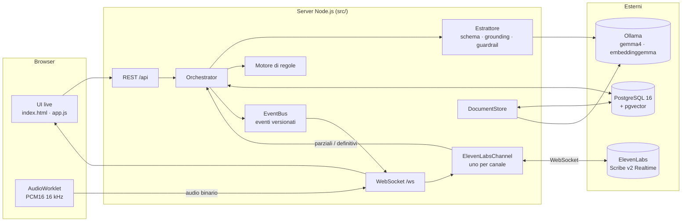
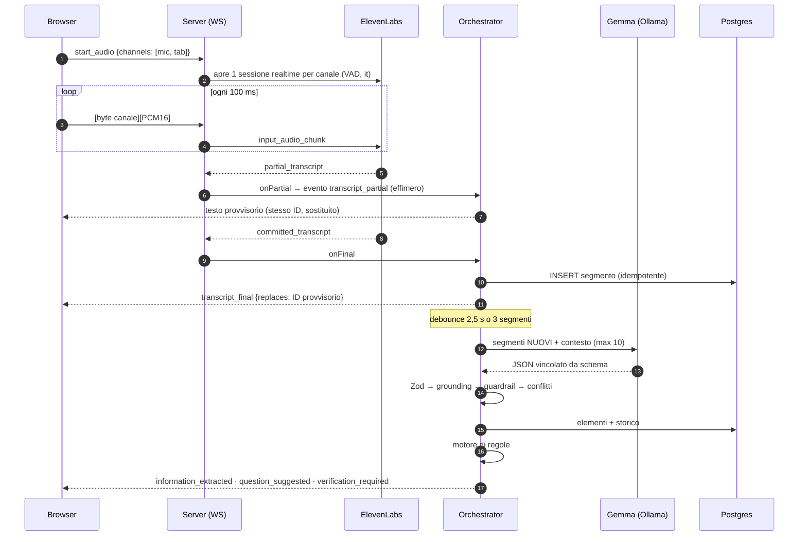
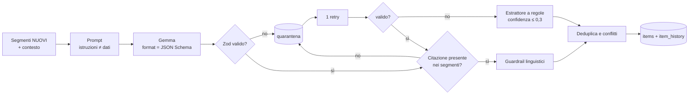
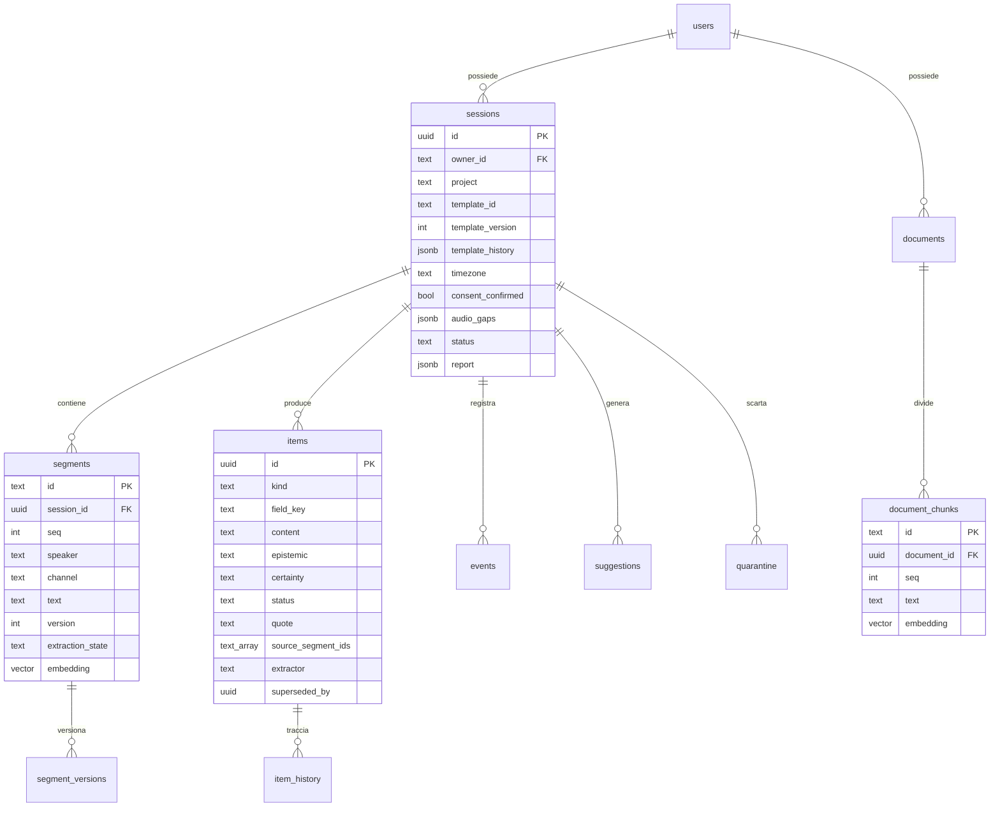
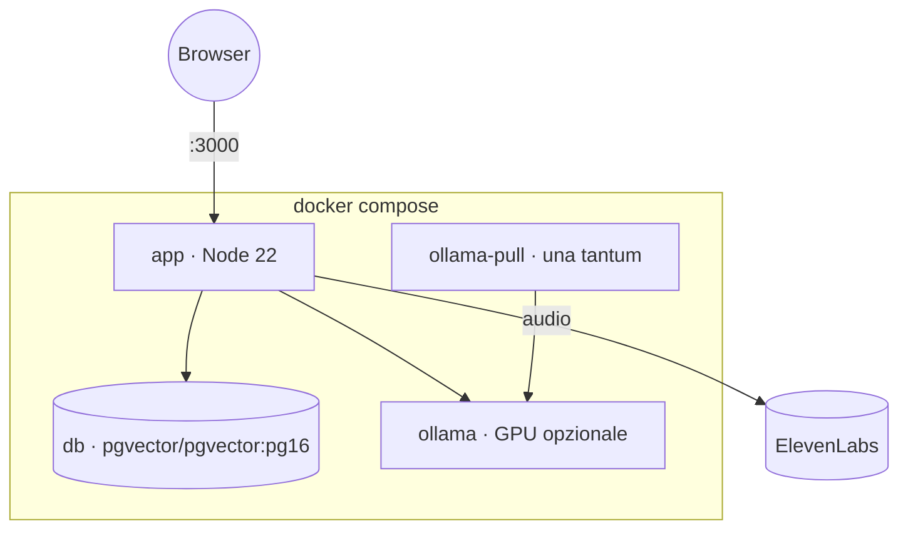

# Architettura

Questo documento descrive come è costruito il prototipo, perché è fatto così e dove sono i suoi limiti.
Implementa la specifica in [docs/prompt-master.md](docs/prompt-master.md) e tiene conto dei rischi analizzati in
[analisi_critica_use_case_scenari_rottura.md](analisi_critica_use_case_scenari_rottura.md).

- [1. Obiettivo e principi](#1-obiettivo-e-principi)
- [2. Vista d'insieme](#2-vista-dinsieme)
- [3. Flusso live](#3-flusso-live-dalla-voce-al-feedback)
- [4. Pipeline di estrazione e guardrail](#4-pipeline-di-estrazione-e-guardrail)
- [5. Motore di regole e template](#5-motore-di-regole-e-template)
- [6. Livello post-chiamata](#6-livello-post-chiamata)
- [7. Memoria, documenti e ricerca](#7-memoria-documenti-e-ricerca)
- [8. Modello dati](#8-modello-dati)
- [9. Contratto degli eventi](#9-contratto-degli-eventi)
- [10. API](#10-api)
- [11. Sicurezza, privacy e governance](#11-sicurezza-privacy-e-governance)
- [12. Deployment](#12-deployment)
- [13. Scelte tecniche](#13-scelte-tecniche)
- [14. Test](#test)
- [15. Limiti e prossimi passi](#15-limiti-e-prossimi-passi)

---

## 1. Obiettivo e principi

Caso d'uso della prima versione, scelto come raccomandato dall'analisi critica: **estrarre impegni, scadenze,
decisioni e domande aperte da chiamate di lavoro**, con template diversi a seconda del contesto (commerciale,
operativo, decisionale, riunione).

Il rischio principale non è una parola trascritta male, ma un errore che **diventa memoria affidabile** e poi
sostiene una decisione. Da qui cinque principi che attraversano tutto il codice:

1. **Provenienza obbligatoria.** Ogni informazione estratta porta con sé la citazione letterale e gli ID dei
   segmenti da cui deriva. Se la citazione non compare davvero in quei segmenti, l'informazione viene scartata.
2. **Dichiarazione ≠ fatto.** Ciò che qualcuno ha detto nasce `da_verificare`, mai `confermato`. Lo conferma solo
   un utente. Formulazioni incerte, ipotetiche o condizionate restano `ambiguo`.
3. **Mai sovrascrivere in silenzio.** Un valore nuovo non cancella il precedente: lo marca come `superato`
   (aggiornamento esplicito) o rende entrambi `contestato` (conflitto). Le correzioni sono versionate.
4. **Il modello propone, il codice decide.** Gemma non ha strumenti e può solo restituire dati validati da uno
   schema. Permessi, persistenza, soglie e alert sono deterministici, nel backend.
5. **Degradare invece di fermarsi.** Se Gemma non risponde o produce output non valido, l'output va in quarantena
   e la pipeline continua con un estrattore di riserva a regole, segnalandolo.

## 2. Vista d'insieme



| Componente | File | Responsabilità |
|---|---|---|
| Server | `src/server.js` | Express (REST + statici), WebSocket live, wiring dei servizi |
| Orchestratore | `src/orchestrator.js` | Sessioni, consolidamento della trascrizione, scheduling dell'estrazione, conflitti, ricerca, report, recovery |
| STT | `src/stt/elevenlabs.js` | Una connessione realtime per canale, buffer durante la riconnessione, retry con backoff |
| Estrattore | `src/extraction/` | Prompt, schema Zod, validazione, grounding delle citazioni, guardrail linguistici, fallback a regole |
| Regole | `src/rules/engine.js` | Quando mostrare domande e alert: regole del template, priorità, deduplica, cooldown, budget |
| Template | `src/templates.js`, `templates/*.json` | Template come dati versionati |
| Documenti | `src/documents.js` | Estrazione testo (txt/md/pdf), suddivisione in blocchi, embedding |
| Eventi | `src/events.js` | Contratto versionato, log idempotente, fan-out ai client |
| Persistenza | `src/db.js` | Schema; adapter unico per PGlite (embedded) e PostgreSQL (`pg`) |

## 3. Flusso live: dalla voce al feedback



**Due canali, due parlanti.** Microfono («Io») e audio della scheda della call («Interlocutore») viaggiano come canali
separati nello stesso WebSocket (il primo byte di ogni frame indica il canale) e sono trascritti da due sessioni
ElevenLabs indipendenti. L'attribuzione del parlante è quindi affidabile e si vede subito se un lato della chiamata
non viene acquisito (scenario F01).

**Parziali senza duplicati.** I parziali condividono un ID provvisorio per canale (`live-mic-3`) e non vengono
salvati. Il definitivo riceve un ID stabile, viene inserito con `ON CONFLICT DO NOTHING` e dichiara quale provvisorio
sostituisce (TC02, F02).

**Gemma non a ogni parola.** L'estrazione parte solo sui segmenti definitivi, a gruppi: dopo 2,5 s di quiete o quando
si accumulano 3 segmenti. Una sola estrazione per sessione alla volta; al modello arrivano i segmenti nuovi più una
finestra di contesto limitata, mai l'intera trascrizione (TC18, F20).

**Interruzioni visibili.** Una caduta del WebSocket del browser, della sessione STT o un riavvio del server
producono `connection_lost` / `connection_restored` e un intervallo registrato in `sessions.audio_gaps`, mostrato
nella trascrizione e nel report (TC09, F14). Mentre la sessione STT si riconnette, l'audio viene tenuto in un buffer
(fino a 10 s).

## 4. Pipeline di estrazione e guardrail



1. **Prompt.** Le istruzioni stanno nel messaggio di sistema; la trascrizione sta nel messaggio utente, dentro
   `<trascrizione>`, e viene dichiarata come *dato*. Ai segmenti il modello vede alias brevi (`S12`), poi rimappati
   agli ID reali. È una mitigazione, non una barriera: la barriera vera è che Gemma **non ha strumenti** (TC15, F15).
2. **Output vincolato.** Lo schema Zod viene convertito in JSON Schema e passato a Ollama (`format`), quindi
   rivalidato lato server. Lo stesso schema governa tipi, enum e lunghezze massime (TC14, F19).
3. **Grounding.** Per ogni elemento la `quote` deve comparire nei segmenti citati (match normalizzato, oppure almeno
   il 75% delle parole). Se il modello cita il segmento sbagliato ma la frase esiste altrove, la fonte viene
   corretta; altrimenti l'elemento va in quarantena. Le ri-estrazioni dai segmenti di contesto vengono scartate in
   silenzio, perché sono già state estratte.
4. **Guardrail linguistici** (`src/extraction/linguistics.js`). Possono solo **ridurre** la certezza, mai aumentarla:
   - condizionali (*se, purché, a patto che…*) → `condizionato` (FC03, caso A);
   - formulazioni incerte (*credo, dovrebbe, verso, in linea di massima…*) → `ambiguo` (TC05);
   - proposte (*potremmo chiedere a Giulia*) → `ipotetico`, e il responsabile diventa «proposto» (FC04);
   - negazione presente nella fonte ma persa nel contenuto → `negato` più segnalazione (FC01);
   - autocorrezioni (*anzi, o meglio, cioè*) → da verificare (FC02, F04).

   Le regex usano confini di parola Unicode, perché il `\b` di JavaScript non riconosce le lettere accentate
   (*purché*, *venerdì*).
5. **Date relative** (*venerdì*, *domani alle nove*, *il 15 novembre*) vengono risolte sulla **data e il fuso
   orario della conversazione**, mai sull'orologio del server, e la formulazione originale viene conservata. Senza
   fuso orario la data resta relativa e da confermare (TC17, F07). *Fine mese* e *prossima settimana* restano vaghe
   di proposito.
6. **Confidenza qualitativa e spiegata**: dipende dalla certezza e da quante penalità sono scattate; i motivi stanno
   in `status_reason`. Non è una probabilità calibrata (F22).

**Tassonomia.** `kind`: fact, commitment, decision, need, risk, open_question, field. `epistemic`: dichiarazione,
fatto_verificato, inferenza, ipotesi, raccomandazione. `certainty`: certo, condizionato, ipotetico, ambiguo, negato.

| Stato | Significato |
|---|---|
| `non_specificato` | richiesto dal template ma non detto |
| `ambiguo` | vago, ipotetico o condizionato |
| `da_verificare` | dichiarato chiaramente, non ancora confermato da una persona |
| `confermato` | confermato da un utente (con autore e data nello storico) |
| `contestato` | in conflitto con un'altra dichiarazione |
| `superato` | sostituito da un aggiornamento esplicito o da una correzione della fonte |

**Conflitti nella stessa sessione.** Se per lo stesso campo arriva un valore diverso: con un marcatore di
aggiornamento (*spostata, rimandata, invece, nuova data…*) il valore precedente diventa `superato` e punta al nuovo;
senza marcatore entrambi diventano `contestato` e scatta un alert ad alta priorità. Le fonti restano tutte (TC06, F09).

## 5. Motore di regole e template

Il motore (`src/rules/engine.js`) decide **cosa mostrare e quando**. Gemma propone domande, ma è il motore che
decide se mostrarle.

- **Sempre mostrati** (alta priorità): istruzioni ostili pronunciate in chiamata e conflitti tra valori.
- **Regole del template**: `text_matches` (regex su un segmento), `kind` + `certainty_in` (su un elemento estratto),
  `field` + `status_in` (sullo stato di un campo), con `after_segments` per non scattare troppo presto.
- **Campi obbligatori mancanti**: dopo un numero minimo di segmenti, **una sola domanda per volta**, prima la più critica.
- **Anti-rumore** (F13, FC07, caso D): una sola istanza per chiave di deduplica (vince la priorità più alta,
  regola di conflitto esplicita), cooldown per domanda, budget di suggerimenti al minuto definito nel template.
  Nella UI le domande la cui risposta è emersa nel frattempo vengono segnate come risolte.
- In **modalità `sintetica`** non vengono proposte domande live.

**Template come dati.** Un template (`templates/*.json`, validato con Zod) definisce: obiettivo, contesto, modalità
(sintetica / esplorativa / verifica / decisionale / monitoraggio / critica), cosa cercare, campi (obbligatori,
critici, con la domanda associata), regole, budget di feedback, escalation verso la conferma umana e casi di test.
Salvarne uno con un ID esistente crea una **nuova versione** e archivia la precedente in `templates/archive/`.
Sessioni ed elementi conservano la versione con cui sono stati prodotti; un cambio di template durante la chiamata
viene tracciato in `template_history` (TC21).

La stessa frase produce feedback diversi a seconda del template (TC12). Per esempio, *«Possiamo consegnare a
dicembre, se riceviamo i materiali entro il 15 novembre. Il prezzo è ancora da confermare.»*:

| Template | Feedback |
|---|---|
| commerciale | «Prezzo non confermato» |
| operativo | «Dipendenza da un input esterno, tracciarne la scadenza» |
| decisionale | «Rischio di ritardo» |

## 6. Livello post-chiamata

Quando si termina la chiamata (`POST /api/sessions/:id/complete`):

1. si completano le estrazioni ancora in coda;
2. **confronto con le sessioni precedenti** dello stesso utente e progetto, ordinate per data della conversazione:
   per ogni campo cambiato si riportano il valore precedente e quello attuale, con le fonti (TC06, FC06);
3. **confronto con i documenti**: per ogni campo compilato si recupera il passaggio più simile tra i documenti del
   progetto e lo si affianca al valore detto in chiamata. **Nessun verdetto automatico**: chi ha ragione lo decide
   una persona;
4. **sintesi di Gemma** su trascrizione ed elementi, etichettata «da verificare», con punti aperti e cose che
   richiedono conferma umana; senza modello si usa una sintesi deterministica;
5. completezza dei campi obbligatori, impegni, decisioni, conflitti, interruzioni audio; export in Markdown.

Il report si può rigenerare (`POST /api/sessions/:id/report`), per esempio dopo una correzione.

**Correzioni manuali** (TC13, FC09, F18): correggere un segmento ne crea una nuova versione (`segment_versions`
conserva anche l'originale dello STT), marca come `superato` tutti gli elementi derivati da quel segmento e lo rimette
in coda all'estrazione: i dati dipendenti vengono ricalcolati e lo storico resta.

## 7. Memoria, documenti e ricerca

**Documenti di riferimento** (`src/documents.js`): listini, contratti e note (txt, md, csv, json; pdf tramite
`unpdf`) oppure testo incollato. Vengono divisi in blocchi di circa 900 caratteri rispettando paragrafi e frasi, con
150 caratteri di sovrapposizione, e indicizzati con `embeddinggemma`. Sono **fonti autorizzate**, sempre etichettate
come `documento` e mai confuse con ciò che è stato detto.

**Import di conversazioni**: una trascrizione testuale (`Nome: testo`, con orari opzionali) passa nella stessa
pipeline dell'audio (segmenti → Gemma → regole → report), con la data originale, così le date relative si risolvono
correttamente. È il modo per partire con uno storico reale.

**Ricerca ibrida** su segmenti e blocchi di documenti:

1. **filtro di autorizzazione per primo**, dentro ogni query: utente, poi progetto, poi sessione (TC16, F16, FC08);
2. ricerca testuale (`ILIKE` sulle parole significative) e semantica (pgvector, distanza coseno, indice HNSW
   `m=16, ef_construction=64`); i punteggi vengono fusi e i doppioni rimossi;
3. **domanda a Gemma** solo sulle evidenze trovate, ciascuna etichettata CONVERSAZIONE o DOCUMENTO; le citazioni
   restituite vengono filtrate e quelle inventate scartate;
4. senza evidenze sufficienti la risposta è un rifiuto esplicito, non un'ipotesi plausibile (TC11).

## 8. Modello dati



Altre tabelle: `events` (log idempotente), `suggestions`, `quarantine` (output del modello scartati, con fase ed
errore), `metrics` (latenze per fase). Tutte le tabelle derivate hanno `ON DELETE CASCADE` sulla sessione o sul
documento: **eliminare una sessione cancella trascrizione, embedding, elementi, eventi e suggerimenti**.

Indici: HNSW coseno su `segments.embedding` e `document_chunks.embedding`; GIN su `items.source_segment_ids`; B-tree
su proprietario, progetto, sessione e sequenza.

## 9. Contratto degli eventi

Versione schema `1.0`. Stessa forma sul WebSocket e nel database:

```json
{
  "event_id": "…", "session_id": "…", "seq": 42, "ts": "2026-10-24T10:02:11Z",
  "type": "transcript_final", "schema_version": "1.0",
  "segment_id": "6cf28119-mic-4", "speaker": "Io",
  "payload": { "text": "…", "channel": "mic", "seq": 4, "replaces": "live-mic-4" },
  "processing_state": "done"
}
```

Tipi: `audio_started`, `audio_stopped`, `transcript_partial`, `transcript_final`, `transcript_corrected`,
`speaker_changed`, `information_extracted`, `verification_required`, `question_suggested`, `decision_detected`,
`action_item_detected`, `connection_lost`, `connection_restored`, `extraction_failed`, `session_completed`,
`report_ready`.

- `event_id` è univoco: un evento ripetuto è un no-op (`ON CONFLICT DO NOTHING`).
- `seq` è monotono per sessione e dà l'ordinamento.
- `transcript_partial` è effimero: viene trasmesso ma non salvato.

## 10. API

| Metodo | Percorso | Descrizione |
|---|---|---|
| GET | `/api/health` | Stato di STT, LLM, embedding e DB, più i flussi di dati verso l'esterno |
| GET/POST | `/api/sessions` | Elenco / creazione (richiede `consent: true`) |
| POST | `/api/sessions/import` | Import di una conversazione da testo |
| GET/DELETE | `/api/sessions/:id` | Stato completo / eliminazione a cascata |
| POST | `/api/sessions/:id/complete` | Fine chiamata: livello post-chiamata |
| POST | `/api/sessions/:id/report` | Rigenera il report |
| POST | `/api/sessions/:id/template` | Cambio template tracciato |
| POST | `/api/sessions/:id/simulate` | Scenario demo in streaming |
| GET | `/api/sessions/:id/report.md` · `/events` | Report in Markdown · log degli eventi |
| PATCH | `/api/segments/:id` · GET `…/history` | Correzione versionata · storico |
| PATCH | `/api/items/:id` · GET `…/history` | Conferma o contestazione · audit trail |
| POST | `/api/ask` | Domanda con fonti (`session_id` / `project`, `include_documents`, `include_conversations`) |
| POST | `/api/search` | Ricerca ibrida senza LLM |
| GET/POST/DELETE | `/api/documents[/:id]` | Documenti (`text` oppure `filename` + `content_base64`) |
| GET | `/api/projects` | Progetti con il numero di conversazioni e documenti |
| POST/GET | `/api/demo/seed` | Carica i dati di partenza (`samples/demo.json`) / avanzamento |
| GET/POST | `/api/templates` | Elenco / nuova versione |
| GET | `/api/metrics` | Latenze (mediana, p95) e output in quarantena |
| WS | `/ws?session=&user=` | In uscita: eventi. In ingresso: frame audio e `start_audio` / `stop_audio` |

## 11. Sicurezza, privacy e governance

| Aspetto | Implementazione |
|---|---|
| **Consenso** | Non si può creare una sessione né importare una trascrizione senza confermare l'autorizzazione |
| **Isolamento** | Ogni query filtra per proprietario **prima** di recupero e ranking; una risorsa di un altro utente risponde «non trovata», come se non esistesse |
| **Istruzioni nel parlato** | Trattate come dati: nessuno strumento al modello, permessi nel backend, alert «istruzione pronunciata» |
| **Flussi esterni dichiarati** | Solo l'**audio** esce verso ElevenLabs. Testo, embedding e DB restano locali (anche in Docker). La UI mostra il badge «Dati esterni» e `/api/health` elenca i flussi; un Ollama remoto verrebbe segnalato |
| **Segreti** | La chiave STT vive solo lato server (`.env`, escluso da git e dall'immagine Docker); il browser non la vede mai |
| **Tracciabilità** | Storico di elementi e versioni dei segmenti, con autore e data; log degli eventi |
| **Cancellazione** | A cascata su tutti i derivati, embedding compresi |
| **Supervisione umana** | Gli elementi critici richiedono conferma (`escalation` nel template); il report elenca le cose «da verificare prima di decidere» |

**Non ancora presenti, e da aggiungere prima di usare dati reali:**
- autenticazione vera (oggi l'utente è un header di demo);
- cifratura a riposo;
- politiche di conservazione con scadenza automatica;
- HTTPS (necessario anche per usare il microfono fuori da localhost).

## 12. Deployment



| Modalità | Database | LLM | Uso |
|---|---|---|---|
| **Docker** (`docker-compose.yml`, più `docker-compose.gpu.yml` per la GPU) | PostgreSQL 16 + pgvector, volume `pgdata` | Ollama in container, modelli nel volume `ollama` (o cartella host con `OLLAMA_DATA`) | Riproducibile ovunque |
| **Nativa** (`setup.ps1` / `start.ps1` / `stop.ps1`) | PGlite + pgvector embedded nel processo, `data/pgdata` | Ollama sull'host | Sviluppo, demo offline |

Lo stesso codice gira su entrambi i database grazie a un adapter con l'interfaccia `query(sql, params)`: lo schema e le
query sono identici. Il percorso `pg` è stato verificato sia contro PostgreSQL in Docker sia contro PGlite esposto
via protocollo Postgres. Al riavvio l'orchestratore riprende le estrazioni rimaste in coda, completa i report
interrotti, registra l'intervallo di indisponibilità e indicizza gli embedding mancanti (TC10).

**Prestazioni misurate** (RTX 5050 Laptop 8 GB, `gemma4:e4b-it-qat`, Docker con GPU):

| Fase | Valore misurato |
|---|---|
| Estrazione per gruppo di segmenti | circa 3,4 s in media |
| Dalla frase definitiva al feedback | circa 6 s in media |
| Persistenza di un segmento | circa 5 ms |
| Motore di regole | circa 16 ms |

Le metriche per installazione (mediana e p95) sono in `/api/metrics` e nella scheda *Metriche*. Sono misure su una
macchina, non garanzie.

## 13. Scelte tecniche

| Decisione | Alternative considerate | Motivo |
|---|---|---|
| **ElevenLabs Scribe v2 Realtime** per lo STT | Whisper locale | Streaming vero con parziali e definitivi, VAD lato servizio, buona qualità in italiano senza GPU dedicata. Costo: l'audio esce dalla macchina, ed è dichiarato |
| **Un canale STT per lato della chiamata** | Diarizzazione su un unico flusso | Attribuzione certa, e si vede subito se un lato non è acquisito. Limite: più persone sullo stesso canale hanno un'unica etichetta |
| **`gemma4:e4b-it-qat`** | `gemma2:9b` (nella specifica iniziale), `gemma4:12b` | Entra in 8 GB di VRAM insieme agli embedding con latenza adatta al live; configurabile |
| **Output JSON vincolato + Zod** | Parsing libero del testo | Lo stesso schema vincola la generazione e rivalida il risultato; ciò che non è valido va in quarantena |
| **Grounding delle citazioni** | Fidarsi delle fonti indicate dal modello | Il criterio «nessun riferimento inventato» diventa verificabile a ogni estrazione |
| **PostgreSQL + pgvector** | DB vettoriale separato | Relazionale, JSONB e vettori in un'unica transazione, con filtri di autorizzazione nella stessa query |
| **PGlite embedded** in modalità nativa | Docker obbligatorio | Zero installazione per sviluppo e demo, stesso schema |
| **Regole deterministiche sopra l'LLM** | Lasciar decidere tutto al modello | Priorità, cooldown e sicurezza devono essere prevedibili e testabili |
| **Frontend senza build step** | React o Vite | Avvio immediato, nessuna toolchain; adatto a un prototipo |

## Test

`npm test` esegue 46 test deterministici: un Gemma finto restituisce output controllati, anche malformati, e il
database è PGlite in memoria. `npm run e2e:stt` verifica il percorso audio reale fino a Gemma.

| Caso | Test |
|---|---|
| TC02 parziali senza duplicati · F02 finali idempotenti | `test/pipeline.test.js` |
| TC03 impegni e scadenze · TC17 date relative con il fuso della sessione | `pipeline`, `extractor`, `linguistics` |
| TC04 informazioni mancanti · TC05 ambiguità · FC03 accordo condizionato · FC04 responsabile solo nominato | `extractor`, `linguistics` |
| TC06 / FC06 aggiornamenti e conflitti senza sovrascrittura | `pipeline` |
| TC09 perdita e ripristino della connessione · TC10 persistenza e riavvio | `pipeline` |
| TC11 risposte con fonti, rifiuto senza evidenze, citazioni inventate scartate | `pipeline`, `documents` |
| TC12 template diversi sulla stessa frase · F13 / FC07 suggerimenti non ripetitivi | `rules` |
| TC13 / FC09 correzione con propagazione e storico | `pipeline` |
| TC14 / F19 JSON non valido → quarantena e fallback | `extractor`, `pipeline` |
| TC15 / F15 istruzioni pronunciate trattate come dati | `rules`, `pipeline` |
| TC16 / FC08 isolamento tra utenti e cancellazione a cascata | `pipeline`, `documents` |
| TC21 cambio di template tracciato | `pipeline` |
| FC01 negazione persa · FC02 autocorrezione numerica | `linguistics`, `extractor` |
| Documenti: suddivisione in blocchi, isolamento, etichette nelle risposte · import con data originale | `documents` |

## 15. Limiti e prossimi passi

- **Qualità non ancora misurata.** WER, precisione e richiamo dell'estrazione e correttezza delle fonti vanno
  misurati su un dataset annotato e separato da quello usato per scrivere i prompt (TestCase §5–7).
- **Diarizzazione per voce** sullo stesso canale (per esempio con i `speaker_id` dello STT, o con pyannote).
- **Autenticazione**, cifratura a riposo, conservazione con scadenza, HTTPS.
- **Monitoraggio degli impegni nel tempo** tra sessioni (scadenze vicine o passate), oggi visibile solo nei report.
- **Verifica assistita sui documenti**: oggi i passaggi vengono affiancati per una persona; un passo successivo è
  segnalare le discrepanze, senza decidere al posto suo.
